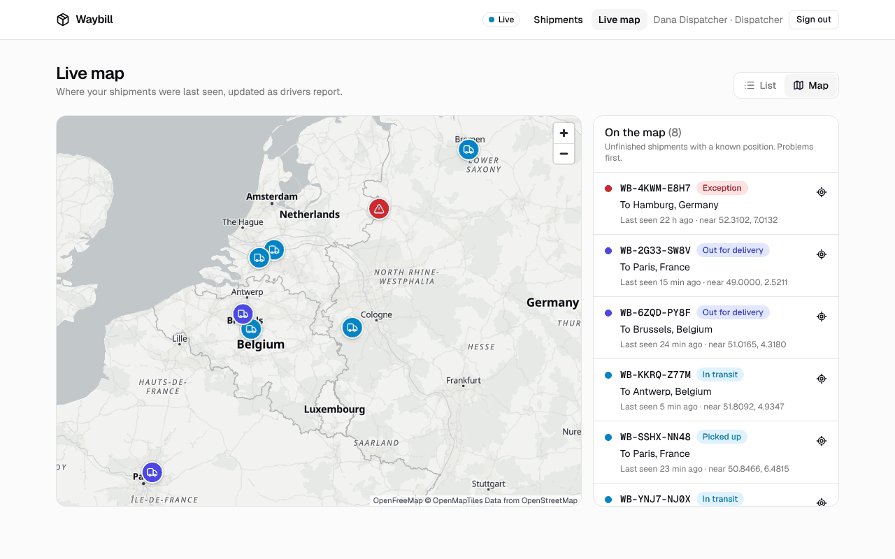
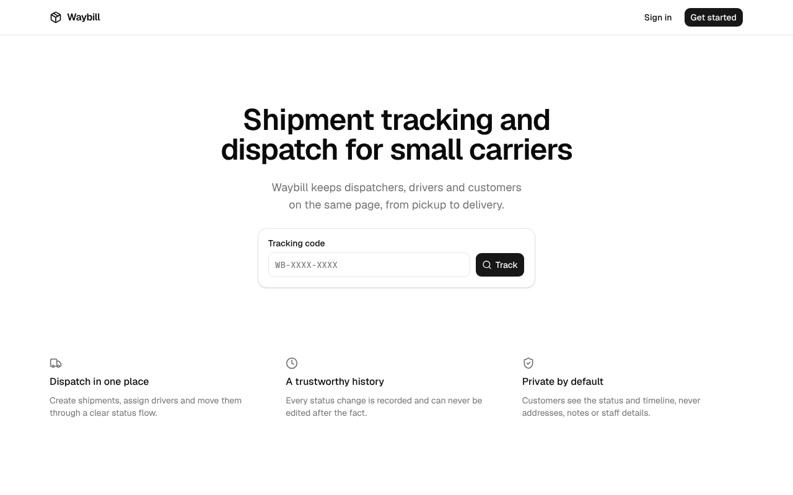
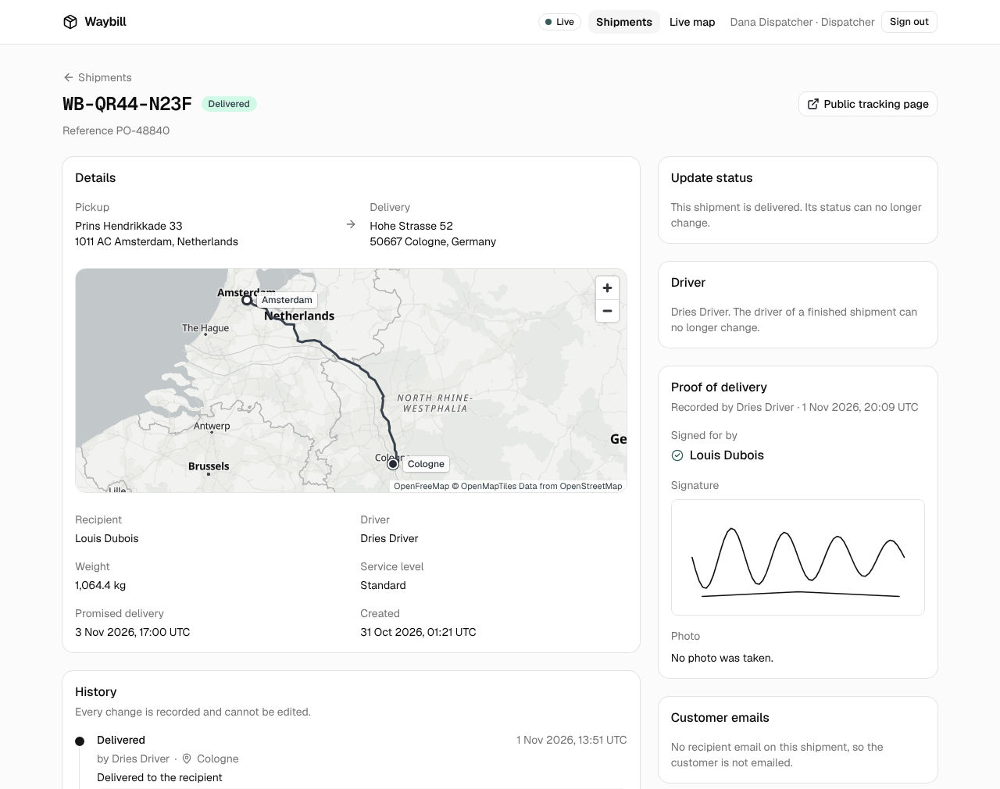
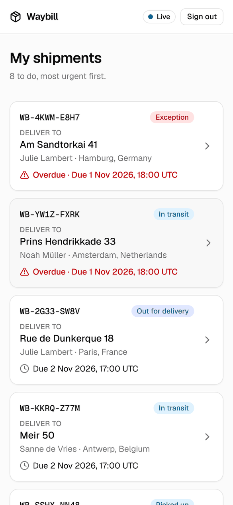
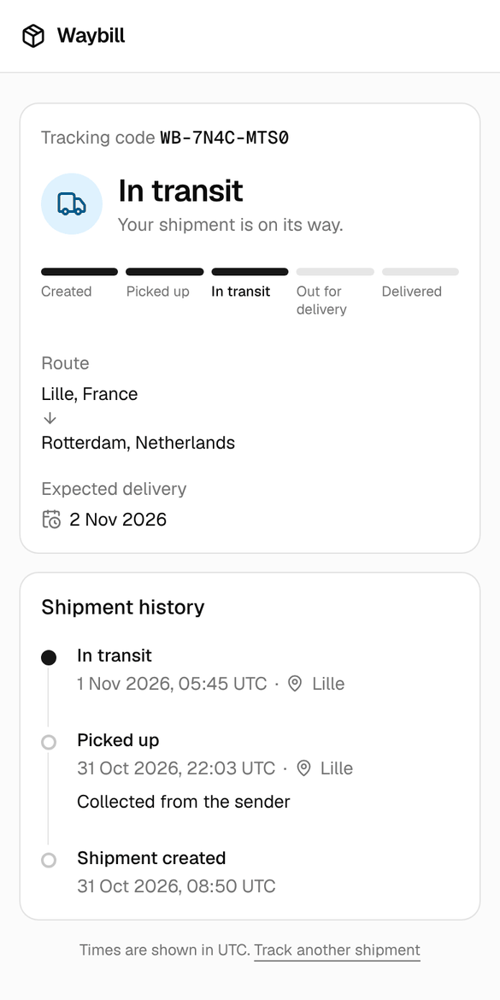
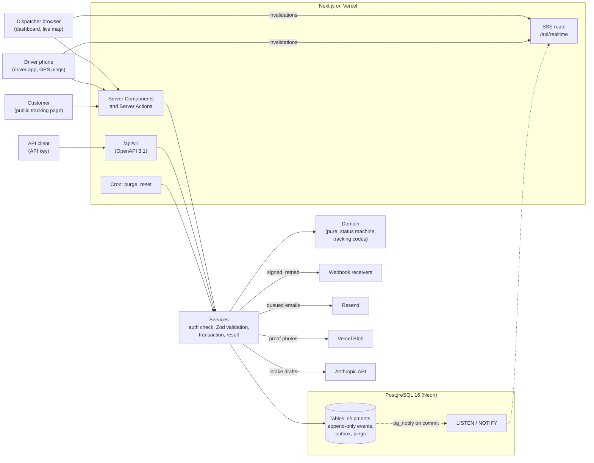

# Waybill

**Multi-tenant shipment tracking and dispatch for small carriers: a strict status machine, live driver
tracking on a map, signed webhooks, and a public API, built to production standards.**

**Live demo: <https://shipment-tracking-platform-xi.vercel.app>**



## Live demo

Open the demo and click **Try the demo** on the sign-in page: three one-click accounts on a seeded
company ("Demo Freight Co", password `demo-password`).

| Account                | Role       | What to try                                                           |
| ---------------------- | ---------- | --------------------------------------------------------------------- |
| `dispatcher@demo.test` | Dispatcher | Book a shipment, assign the driver, change statuses, open the map     |
| `admin@demo.test`      | Admin      | The same, plus API keys, webhooks and email previews                  |
| `driver@demo.test`     | Driver     | The phone-first driver app: only assigned shipments, share a location |

The accounts are shared by everyone and **the data resets every night around 03:00 UTC**. Trucks on
the live map move along real roads. As the demo driver, "Share my location" shares a simulated
position: your real location is never requested. It runs on Vercel and Neon; the whole deployment
(migrations, demo data, nightly reset) is code in this repository ([docs/deployment.md](docs/deployment.md)).

|                                                                          |                                                                                         |
| ------------------------------------------------------------------------ | --------------------------------------------------------------------------------------- |
|                             |                                 |
| **Driver app** (390 px)                                                  | **Public tracking** (390 px, no account)                                                |
|  |  |

The shipment detail shows the real driving route and the proof of delivery (signed name and drawn
signature). The public page never shows addresses, notes, staff names, a map or coordinates.

## Architecture



Routes stay thin and call services, which own authorization, validation and the transaction. The
organization always comes from the server-side session, never from client input. Webhooks and emails
are written to an outbox in the same transaction as the change, then delivered with retries. More in
[docs/architecture.md](docs/architecture.md).

## Highlights for reviewers

- **Status changes cannot be lost or rewritten:** a pure state machine, optimistic concurrency
  (`version`) and an event insert in one transaction; `shipment_events` is append-only, enforced by a
  database trigger. [State machine](docs/engineering-notes.md#shipment-status-as-a-state-machine),
  [append-only history](docs/engineering-notes.md#making-history-impossible-to-rewrite),
  [proving the concurrency guarantee](docs/engineering-notes.md#proving-optimistic-concurrency-actually-works).
- **Tenant isolation in the database as well as the code:** composite foreign keys and a single
  `visibleShipments` scope. [Notes](docs/engineering-notes.md#tenant-isolation-enforced-by-the-database-not-just-the-code).
- **Realtime without a worker or replay log:** Postgres `LISTEN/NOTIFY` fed SSE, with invalidations
  and a resync. [Notes](docs/engineering-notes.md#live-updates-without-a-replay-log-and-the-race-hiding-in-re-fetch-on-reconnect).
- **Race-free throttling:** [location pings](docs/engineering-notes.md#throttling-location-pings-without-a-race),
  proven with a forced race.
- **Webhooks on serverless:** signed, retried, no double delivery, SSRF guard.
  [Notes](docs/engineering-notes.md#webhooks-on-serverless-no-worker-no-double-delivery-no-ssrf).
- **A public API on services built for sessions:** keys stored as hashes, `ETag` / `If-Match`, RFC 9457
  errors. [Notes](docs/engineering-notes.md#a-public-api-on-top-of-services-built-for-sessions), [docs/api.md](docs/api.md).
- **An LLM feature that cannot book, leak or invent:**
  [AI intake](docs/engineering-notes.md#an-llm-feature-that-cannot-book-leak-or-invent) drafts a form; a person books.
- **Proof of delivery, and a CSP test that caught a bundling bug:**
  [notes](docs/engineering-notes.md#proof-of-delivery-and-a-csp-test-that-caught-a-bundling-bug).
- **Accessibility is tested:** an axe e2e spec runs on every main page and fails on serious violations.

## Features

- **Dispatch:** shipments list with search, status filter and pagination; validated create form with
  an unguessable tracking code (`WB-XXXX-XXXX`); detail page with the full history; roles (admin,
  dispatcher, driver); a mobile menu for phones.
- **Driver app** (`/driver`): the driver's own jobs, big status buttons, proof of delivery (printed
  name, drawn signature, photo in private storage) and "Share my location".
- **Live map** (`/dashboard/map`): unfinished shipments at their last known position, with a text list
  beside it for keyboard and screen-reader users. Detail pages draw the road route.
- **Public tracking page:** mobile-first status, progress and timeline, `noindex`, nothing internal.
- **Integrations:** public API with scoped API keys, signed webhooks with a delivery log, customer
  emails (Resend, or a stored preview), AI intake of request emails (Anthropic). Each works without
  its key and degrades visibly.
- **Operations:** daily retention (location pings 30 days, finished webhook and email logs 90 days;
  delivery proofs and shipment history are kept: audit and evidence), rate limits, security headers
  with a CSP.

## Tech stack

Next.js 16 (App Router, Server Actions, Cache Components), TypeScript strict, PostgreSQL 16 with
Drizzle ORM (committed migrations), Better Auth (email/password, organizations), Tailwind CSS and
shadcn/ui, Zod, MapLibre GL with OpenFreeMap tiles, Vitest, Playwright and axe-core. pnpm, Node 22.
Deployed on Vercel and Neon, with GitHub Actions CI.

## Quality

| Check                 | Result                                                                      |
| --------------------- | --------------------------------------------------------------------------- |
| Unit tests            | 740 (59 files)                                                              |
| Integration tests     | 435 (40 files) (real PostgreSQL)                                            |
| End-to-end tests      | 41 tests (Playwright, production build, includes an axe accessibility spec) |
| Coverage              | 88% lines, 84% branches (`pnpm test:coverage`, source files, UI excluded)   |
| AI intake accuracy    | 112/112 fields on 8 fixtures (EN/DE/FR, prompt injection), Claude Haiku 5.5 |
| Lighthouse (landing)  | 96 / 100 / 100 / 100 (performance, accessibility, best practices, SEO)      |
| Lighthouse (sign-in)  | 100 / 100 / 100 / 63 (noindex)                                              |
| Lighthouse (tracking) | 93 / 100 / 100 / 54 (noindex)                                               |

Lighthouse 13, mobile emulation, against a local production build (desktop scores are 100 across
the board). The SEO score on sign-in and tracking is lower by design: those pages are `noindex`
(a tracking code is a secret, and the sign-in page has nothing to index). It is not a CI gate. To
re-run:

```bash
pnpm build && pnpm start &   # needs the dev database, see below
CHROME_PATH=/path/to/chromium pnpm exec lighthouse http://localhost:3000/ \
  --chrome-flags="--headless --no-sandbox" --view
```

## Local setup

Prerequisites: Node 22, pnpm 10, PostgreSQL 16.

1. `pnpm install`
2. Create the role and databases (as the `postgres` superuser):

   ```sql
   CREATE ROLE waybill WITH LOGIN PASSWORD 'waybill' CREATEDB;
   CREATE DATABASE waybill OWNER waybill;
   CREATE DATABASE waybill_test OWNER waybill;
   ```

   The e2e databases are created automatically by `pnpm test:e2e`.

3. `cp .env.example .env`, then set `BETTER_AUTH_SECRET` (`openssl rand -base64 32`).
4. `pnpm db:migrate && pnpm db:seed`, then `pnpm dev` and open http://localhost:3000

Sign in with the demo accounts above. Deploying: [docs/deployment.md](docs/deployment.md). Using the
API: [docs/api.md](docs/api.md).

### Try the live demo locally

1. Load fresh demo data: `pnpm db:seed --reset` (local `waybill` database only).
2. Start the app: `pnpm dev` (or `pnpm build && pnpm start`).
3. Sign in at http://localhost:3000/sign-in as `dispatcher@demo.test` / `demo-password`.
4. In a second terminal, run `pnpm simulate`.
5. Open **Live map**: the trucks move every 12 seconds along real roads, go out for delivery near
   the address and are delivered (they then leave the map, and the simulator books new shipments
   as the demo dispatcher so at least six are always on the road). Now and then one reports an exception
   and carries on a minute later. Open a shipment to see its route and live position, or its
   public tracking page to see the customer's view.

The simulator acts as each shipment's assigned driver through the app's own services, so it obeys
every rule a person does (it cannot cancel, it cannot ping faster than every 10 seconds). It also
picks up assigned shipments still waiting at the sender: assign the demo driver to a new shipment
booked between two demo cities and watch it join. Options: `--speed 60` (time compression, default
30), `--shipments 3`, `--seed 7`, `--once`, `--target 10` (shipments to keep on the road, default
6), `--no-refill` (let the fleet run down instead). Ctrl+C stops it. With `--no-refill`, when everything is
delivered it says so; reseed for another run.

The seed runs once (a re-run is a no-op, because history is never deleted). For fresh dates, run
`pnpm db:seed --reset`, which wipes and re-creates the local `waybill` database only.

## Scripts

| Script               | Purpose                                                         |
| -------------------- | --------------------------------------------------------------- |
| `pnpm dev`           | Next.js dev server                                              |
| `pnpm build`         | Production build                                                |
| `pnpm start`         | Serve the production build                                      |
| `pnpm lint`          | ESLint                                                          |
| `pnpm typecheck`     | Generate route types, then `tsc --noEmit`                       |
| `pnpm format:check`  | Prettier check (`pnpm format` to fix)                           |
| `pnpm test`          | Vitest: unit and integration tests (integration needs Postgres) |
| `pnpm test:coverage` | The same with v8 coverage                                       |
| `pnpm test:e2e`      | Playwright against a production build, own database             |
| `pnpm db:generate`   | Generate a migration from the Drizzle schema                    |
| `pnpm db:migrate`    | Apply migrations to `DATABASE_URL`                              |
| `pnpm db:seed`       | Load the demo data (`--reset` recreates the dev database)       |
| `pnpm auth:generate` | Regenerate the Better Auth tables (must be a no-op change)      |
| `pnpm simulate`      | Drive the demo trucks so the live map moves (dev DB only)       |
| `pnpm intake:eval`   | Score the AI intake model on the committed fixtures             |
| `pnpm routes:fetch`  | One-off: re-fetch the committed road route fixture (OSRM)       |
| `pnpm vercel-build`  | The deploy build: validate env, migrate, seed (demo), build     |

`pnpm test` wipes and re-migrates `TEST_DATABASE_URL` (the name must end in `_test`).
`pnpm test:e2e` does the same for `E2E_DATABASE_URL` (ending in `_e2e`), builds the app and starts it
on port 3100; it uses `PLAYWRIGHT_CHROMIUM` or a preinstalled Chromium if present, otherwise
Playwright's own browser.

## Documentation

- [Deployment guide](docs/deployment.md): Vercel + Neon setup, demo mode, troubleshooting.
- [API guide](docs/api.md): API keys, endpoints, ETag and If-Match, errors, rate limits.
- [Architecture](docs/architecture.md): system design, state machine, multi-tenancy, decisions log.
- [Engineering notes](docs/engineering-notes.md): the problems worth discussing and the tradeoffs.
- [Implementation notes](docs/implementation-notes.md): status, roadmap, gotchas, environment.

## Credits

- Map data and road route geometry © [OpenStreetMap](https://www.openstreetmap.org/copyright)
  contributors, available under the Open Database License (ODbL).
- Map tiles by [OpenFreeMap](https://openfreemap.org/) (OpenMapTiles schema).
- Road routes were computed once with [OSRM](https://project-osrm.org/) and committed as fixtures.
- Built with [Claude Code](https://claude.com/claude-code).
